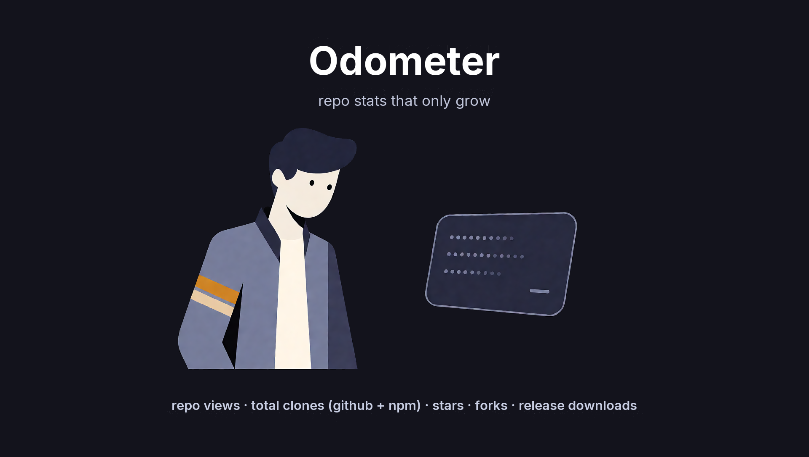

# Odometer

One clean stats line in your README that never lies and never needs babysitting:
**total clones (github + npm) · repo views · stars · forks · release downloads.**

A reusable GitHub Action. It collects from the public + traffic APIs each day,
appends to a CSV in **your** repo, and rewrites one managed block in the README.
All your numbers **only ever grow** — the traffic API reports cumulative counts,
so a down day can't make your stats look bad. The workflow writes with its own
short-lived `GITHUB_TOKEN`; the token you add is a **read-only** one.

## Quick start (3 steps, ~5 minutes)

1. **Add a token** — Settings → Developer settings → Personal access tokens →
   **Tokens (classic)** → *Generate new* (note: if you have 2FA on, GitHub asks
   for your 2FA code right here) → scope: check **`repo`** → expiration 90 days.
2. **Store it** — repo → Settings → Secrets and variables → Actions →
   New repository secret → name `TRAFFIC_TOKEN`.
3. **Add this workflow** to `.github/workflows/odometer.yml`:

   ```yaml
   name: odometer
   on:
     schedule:
       - cron: "0 20 * * *"   # pick a time in your zone
     workflow_dispatch: {}
   jobs:
     refresh:
       uses: Caqtus/odometer/.github/workflows/odometer.yml@v1
       with:
         npm_package: your-pkg   # remove this line (or use "" ) if you have none
       secrets: inherit
   ```

Run Actions → **odometer** → *Run workflow* once to get the first line, or just
wait for the cron. The next day's run will add the first real numbers.

> No npm package? `npm_package` empty → the npm API is never called and every
> npm part (statline sub-part, CSV column, tables) is hidden automatically.

## What you get

- a one-line **stat block** in the README, self-healing — if something (including
  an AI tool) rewrites your README and drops the block, the next run re-inserts it
- `stats/README.md` — totals + last-14-days table + weekly rollups + footnotes
- `stats/daily.csv` — full history, one row per day since the first run
- `stats/downloads.csv` — release download counts (only if you have releases)

Details and FAQ: see this repo's **wiki** (top-right "Wiki" tab).

## Housekeeping

- delete `TRAFFIC_TOKEN` anytime → the run still commits stars/forks/releases,
  traffic rows stay where they were, a warning tells you what got skipped
- remove the workflow + `git rm -r stats` + delete the block between the
  `repo-stats:begin` / `repo-stats:end` markers to uninstall cleanly
